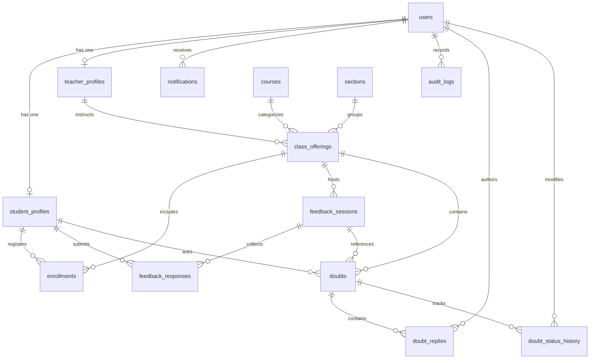

# UniSync &mdash; Database Schema & Architecture

> **Database Engine:** SQLite (Initial / Development & Testing) &bull; SQLAlchemy ORM (PostgreSQL Ready)  
> **Schema Integrity:** Foreign Keys Enforced &bull; Unique Constraints &bull; ACID Transactions  

---

## 1. Entity-Relationship Diagram (ERD)

---

## 2. Table Specifications & Data Dictionary

### 2.1 `users`
Core identity table managing credentials and platform role.

| Column | Type | Constraints | Description |
| :--- | :--- | :--- | :--- |
| `id` | INTEGER | PRIMARY KEY, AUTOINCREMENT | Unique user identifier |
| `email` | VARCHAR(120) | UNIQUE, NOT NULL, INDEX | University email address |
| `password_hash` | VARCHAR(255) | NOT NULL | Werkzeug salted scrypt/pbkdf2 hash |
| `role` | VARCHAR(20) | NOT NULL | Academic role (`student` or `teacher`) |
| `full_name` | VARCHAR(100) | NOT NULL | Legal academic name |
| `is_active` | BOOLEAN | DEFAULT TRUE, NOT NULL | Account state |
| `created_at` | DATETIME | NOT NULL | Account creation timestamp |

### 2.2 `student_profiles`
Specialized attributes for university student accounts.

| Column | Type | Constraints | Description |
| :--- | :--- | :--- | :--- |
| `id` | INTEGER | PRIMARY KEY, AUTOINCREMENT | Profile identifier |
| `user_id` | INTEGER | FOREIGN KEY (`users.id`), UNIQUE, NOT NULL | Linked base user record |
| `roll_number` | VARCHAR(30) | UNIQUE, NOT NULL, INDEX | University enrollment roll number |
| `programme` | VARCHAR(80) | NOT NULL | Degree programme (e.g. B.Tech CSE) |
| `semester` | INTEGER | NOT NULL | Current academic semester (1–12) |
| `section` | VARCHAR(10) | NOT NULL | Academic section code (e.g. A, B) |
| `created_at` | DATETIME | NOT NULL | Profile creation timestamp |

### 2.3 `teacher_profiles`
Specialized attributes for university faculty accounts.

| Column | Type | Constraints | Description |
| :--- | :--- | :--- | :--- |
| `id` | INTEGER | PRIMARY KEY, AUTOINCREMENT | Profile identifier |
| `user_id` | INTEGER | FOREIGN KEY (`users.id`), UNIQUE, NOT NULL | Linked base user record |
| `faculty_id` | VARCHAR(30) | UNIQUE, NOT NULL, INDEX | Official university employee ID |
| `department` | VARCHAR(80) | NOT NULL | Academic department name |
| `created_at` | DATETIME | NOT NULL | Profile creation timestamp |

### 2.4 `courses`
Academic subjects catalog.

| Column | Type | Constraints | Description |
| :--- | :--- | :--- | :--- |
| `id` | INTEGER | PRIMARY KEY, AUTOINCREMENT | Course record identifier |
| `code` | VARCHAR(20) | UNIQUE, NOT NULL, INDEX | Official course code (e.g. CS101) |
| `name` | VARCHAR(120) | NOT NULL | Full course title |
| `description` | TEXT | NULLABLE | Syllabus / course overview |
| `credits` | INTEGER | DEFAULT 3, NOT NULL | Academic credit weighting |
| `created_at` | DATETIME | NOT NULL | Catalog registration timestamp |

### 2.5 `sections`
Academic cohort and division identifiers.

| Column | Type | Constraints | Description |
| :--- | :--- | :--- | :--- |
| `id` | INTEGER | PRIMARY KEY, AUTOINCREMENT | Section identifier |
| `name` | VARCHAR(30) | NOT NULL | Division label (e.g. CSE-A) |
| `programme` | VARCHAR(80) | NOT NULL | Degree programme |
| `semester` | INTEGER | NOT NULL | Semester number |
| `created_at` | DATETIME | NOT NULL | Registration timestamp |

### 2.6 `class_offerings`
The critical join linking a course, a specific cohort section, and an assigned faculty instructor.

| Column | Type | Constraints | Description |
| :--- | :--- | :--- | :--- |
| `id` | INTEGER | PRIMARY KEY, AUTOINCREMENT | Offering identifier |
| `course_id` | INTEGER | FOREIGN KEY (`courses.id`), NOT NULL | Assigned course |
| `section_id` | INTEGER | FOREIGN KEY (`sections.id`), NOT NULL | Cohort section |
| `teacher_id` | INTEGER | FOREIGN KEY (`teacher_profiles.id`), NOT NULL | Assigned faculty instructor |
| `join_code` | VARCHAR(16) | UNIQUE, NOT NULL, INDEX | Student self-enrollment code |
| `semester` | INTEGER | NOT NULL | Active semester |
| `academic_year` | VARCHAR(20) | NOT NULL | e.g. 2026-2027 |
| `is_active` | BOOLEAN | DEFAULT TRUE, NOT NULL | Course status |
| `created_at` | DATETIME | NOT NULL | Offering creation timestamp |

### 2.7 `enrollments`
Maps student profiles to assigned course-section offerings.

| Column | Type | Constraints | Description |
| :--- | :--- | :--- | :--- |
| `id` | INTEGER | PRIMARY KEY, AUTOINCREMENT | Enrollment identifier |
| `student_id` | INTEGER | FOREIGN KEY (`student_profiles.id`), NOT NULL | Enrolled student |
| `class_offering_id` | INTEGER | FOREIGN KEY (`class_offerings.id`), NOT NULL | Targeted course offering |
| `enrolled_at` | DATETIME | NOT NULL | Enrollment timestamp |
| *Composite* | UNIQUE | `(student_id, class_offering_id)` | Prevents duplicate enrollments |

### 2.8 `feedback_sessions`
Dynamic classroom check-in events governed by a strict 45-second timer.

| Column | Type | Constraints | Description |
| :--- | :--- | :--- | :--- |
| `id` | INTEGER | PRIMARY KEY, AUTOINCREMENT | Session identifier |
| `class_offering_id` | INTEGER | FOREIGN KEY (`class_offerings.id`), NOT NULL | Course section |
| `session_token` | VARCHAR(64) | UNIQUE, NOT NULL, INDEX | Opaque cryptographic token |
| `started_at` | DATETIME | NOT NULL | Session start timestamp |
| `expires_at` | DATETIME | NOT NULL | Exact cutoff timestamp ($t + 45\text{s}$) |
| `status` | VARCHAR(20) | NOT NULL | `active` or `closed` |
| `created_at` | DATETIME | NOT NULL | Timestamp |

### 2.9 `feedback_responses`
Student understanding and satisfaction records tied authoritatively to enrolled accounts.

| Column | Type | Constraints | Description |
| :--- | :--- | :--- | :--- |
| `id` | INTEGER | PRIMARY KEY, AUTOINCREMENT | Response identifier |
| `session_id` | INTEGER | FOREIGN KEY (`feedback_sessions.id`), NOT NULL | Parent session |
| `student_id` | INTEGER | FOREIGN KEY (`student_profiles.id`), NOT NULL | Authenticated student profile |
| `understanding` | VARCHAR(30) | NOT NULL | `understood`, `partially`, `needs_help` |
| `satisfaction` | INTEGER | NOT NULL | Integer rating (1–5) |
| `concept_feedback` | TEXT | NULLABLE | Freeform concept clarification note |
| `submitted_at` | DATETIME | NOT NULL | Client arrival timestamp (validated $\le \text{expires\_at}$) |
| *Composite* | UNIQUE | `(session_id, student_id)` | Enforces single submission per student |

### 2.10 `doubts` (Student Questions)
Academic questions submitted to course instructors.

| Column | Type | Constraints | Description |
| :--- | :--- | :--- | :--- |
| `id` | INTEGER | PRIMARY KEY, AUTOINCREMENT | Question identifier |
| `class_offering_id` | INTEGER | FOREIGN KEY (`class_offerings.id`), NOT NULL | Associated course section |
| `student_id` | INTEGER | FOREIGN KEY (`student_profiles.id`), NOT NULL | Author student profile |
| `feedback_session_id`| INTEGER | FOREIGN KEY (`feedback_sessions.id`), NULLABLE | Optional link to lecture session |
| `title` | VARCHAR(200) | NOT NULL | Core doubt headline |
| `explanation` | TEXT | NOT NULL | In-depth description |
| `status` | VARCHAR(20) | NOT NULL | `new`, `viewed`, `answered`, `resolved` |
| `created_at` | DATETIME | NOT NULL | Creation timestamp |
| `updated_at` | DATETIME | NOT NULL | Last activity timestamp |

### 2.11 `doubt_replies`
Discussion replies from instructors and students.

| Column | Type | Constraints | Description |
| :--- | :--- | :--- | :--- |
| `id` | INTEGER | PRIMARY KEY, AUTOINCREMENT | Reply identifier |
| `doubt_id` | INTEGER | FOREIGN KEY (`doubts.id`), NOT NULL | Parent question |
| `author_id` | INTEGER | FOREIGN KEY (`users.id`), NOT NULL | Author user record |
| `message` | TEXT | NOT NULL | Reply body |
| `created_at` | DATETIME | NOT NULL | Post timestamp |

### 2.12 `doubt_status_history`
Audit trail of question lifecycle transitions.

| Column | Type | Constraints | Description |
| :--- | :--- | :--- | :--- |
| `id` | INTEGER | PRIMARY KEY, AUTOINCREMENT | History identifier |
| `doubt_id` | INTEGER | FOREIGN KEY (`doubts.id`), NOT NULL | Targeted doubt |
| `changed_by_id` | INTEGER | FOREIGN KEY (`users.id`), NULLABLE | Actor |
| `old_status` | VARCHAR(20) | NULLABLE | Prior state |
| `new_status` | VARCHAR(20) | NOT NULL | Resulting state |
| `note` | VARCHAR(255) | NULLABLE | Contextual explanation |
| `changed_at` | DATETIME | NOT NULL | Transition timestamp |

### 2.13 `notifications`
In-app notification queue for students and faculty.

| Column | Type | Constraints | Description |
| :--- | :--- | :--- | :--- |
| `id` | INTEGER | PRIMARY KEY, AUTOINCREMENT | Notification identifier |
| `user_id` | INTEGER | FOREIGN KEY (`users.id`), NOT NULL | Recipient user |
| `title` | VARCHAR(150) | NOT NULL | Brief headline |
| `message` | TEXT | NOT NULL | Detailed alert |
| `link` | VARCHAR(255) | NULLABLE | Destination URI |
| `is_read` | BOOLEAN | DEFAULT FALSE, NOT NULL | Read status |
| `created_at` | DATETIME | NOT NULL | Timestamp |

### 2.14 `audit_logs`
Compliance and security event trail.

| Column | Type | Constraints | Description |
| :--- | :--- | :--- | :--- |
| `id` | INTEGER | PRIMARY KEY, AUTOINCREMENT | Log entry identifier |
| `user_id` | INTEGER | FOREIGN KEY (`users.id`), NULLABLE | Actor user |
| `action` | VARCHAR(80) | NOT NULL | e.g. `FEEDBACK_SUBMIT`, `USER_LOGIN` |
| `entity_type` | VARCHAR(50) | NULLABLE | Target model |
| `entity_id` | INTEGER | NULLABLE | Target primary key |
| `details` | TEXT | NULLABLE | Context string |
| `ip_address` | VARCHAR(45) | NULLABLE | IPv4/IPv6 client address |
| `created_at` | DATETIME | NOT NULL | Log timestamp |
